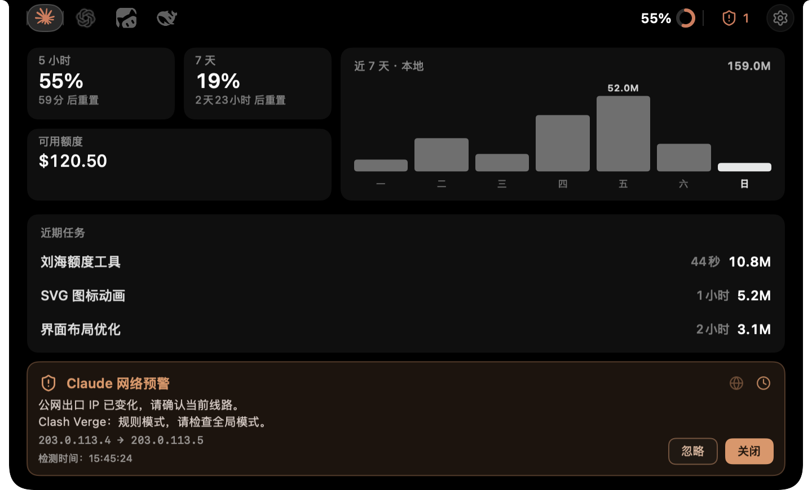
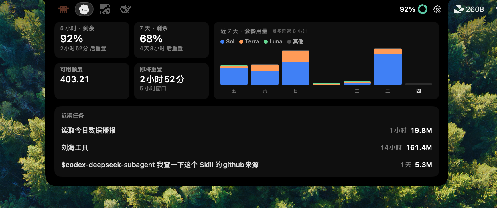
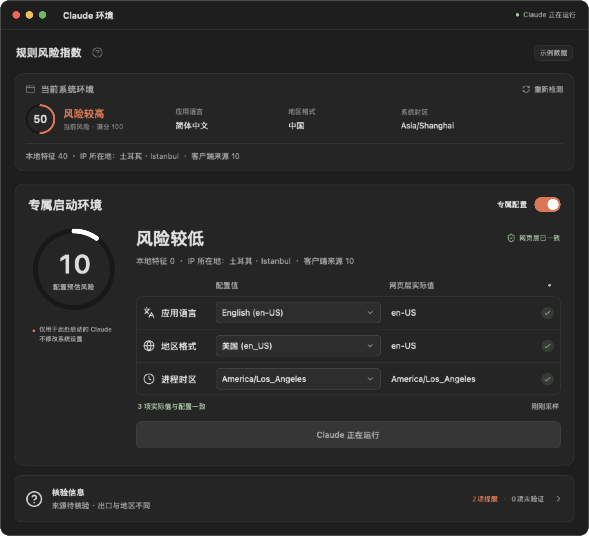
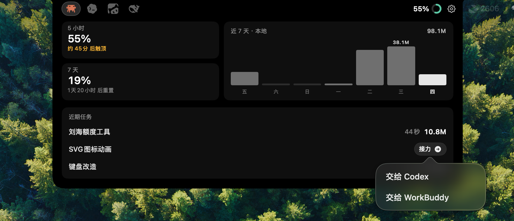

<div align="center">

# Claude Notch 中文版

**额度监测与 Claude 环境守护，常驻你的 Mac 刘海。**

查看 Claude、Codex、WorkBuddy、DeepSeek 的额度与余额，掌握用量、消费趋势和重置时间。

v1.1.2 新增网络预警与启动前检查：出口改变及时提醒，启动、重启和任务接力前先确认网络。

[](https://github.com/cenzihao1987-svg/claude-notch-zh-cn/releases/latest)
&nbsp; 
&nbsp; [](LICENSE)

[English](README.en.md) · [获取源码](https://github.com/cenzihao1987-svg/claude-notch-zh-cn/releases) · [v1.1.2 更新介绍](RELEASE_NOTES_v1.1.2.md)

</div>

## 网络异常，刘海及时提醒 · v1.1.2



完整展开界面：额度、近七天图表和近期任务下方显示异常 tips；右上角网络图标位于历史图标左侧，操作区仅保留“忽略”“关闭”。图中的额度、任务名和 IP 均为演示数据。

- **出口变化提醒**：包括同国换 IP，经间隔 5 秒复测后提醒；IPv4、IPv6 分别比较。
- **Clash 模式检查**：读取内核当前模式；非全局、未运行或无法核验时提示。
- **启动前确认**：从本工具启动、重启或任务接力前统一检查。异常时可取消，也可明确选择“仍然启动”；取消后停止后续操作。
- **自动复查与便捷处理**：运行中每 30 秒复查，网络切换和应用启动等事件触发即时检查。支持系统通知，通过网络图标打开当前使用的 VPN 工具。
- **历史与评分独立**：本机记录出口与风险变化；同国换 IP 提醒不增加跨区评分，忽略不清除风险历史。

## 常驻刘海，额度与守护随时可见


额度与环境盾牌常驻刘海。点击盾牌，即可打开独立的 Claude 环境窗口。

## 多工具额度监测

收起时快速看额度，悬停展开查看用量、重置时间、趋势图与近期任务；不同工具展示各自支持的数据。



额度监测界面，复用既有版本截图。

| 工具 | 主要信息 |
| --- | --- |
| **Claude** | 5 小时、7 天额度及重置时间；按套餐显示适用信息，结合本地用量与近期任务。 |
| **Codex** | 剩余额度、可用积分、重置时间，近 7 天 Sol / Terra / Luna 套餐用量与近期任务。 |
| **WorkBuddy** | 剩余与已用积分、套餐、刷新或到期时间，以及近 7 天本机积分消耗。 |
| **DeepSeek** | 可用余额、充值与赠金余额，以及从下载的导出文件读取的近 7 天消费。 |

读取暂时失败时，已有有效额度保留并标明尚未更新；可点击失败提示旁的刷新图标重试。

## Claude 环境守护 · v1.1.0 新增

**给 Claude 一套独立专属环境，无需改变 Mac 的全局配置。**

在刘海查看环境封号风险，独立设置 Claude 的语言、地区和时区，并核对网页层实际读到的值。



配置值、网页层实际值与出口所在地集中展示；窗口失去焦点后仍保留。图中为示例数据，50、10 为风险指数示例。

| 能力 | 帮你做什么 |
| --- | --- |
| **专属环境** | 为 Claude 独立设置语言、地区和时区，保持 Mac 全局配置与日常使用习惯。 |
| **实际核验** | 并排对照配置值与网页层实际值，结合 IP 所在国家和城市，发现配置未生效、时区与出口所在地不一致等风险。 |
| **风险可见** | 对比当前系统与专属配置的风险指数，查看本地特征、出口所在地及客户端核验信息。 |
| **便捷调整** | 选择地区后联动推荐时区，记住按地区手动修改的选择，应用配置并启动 Claude。 |

## 三步开始

1. **打开守护窗口**：在 Claude 页点击刘海中的环境盾牌。
2. **选择专属配置**：开启“专属配置”，设置应用语言、地区格式和进程时区。
3. **启动并核验**：点击“应用配置并启动 Claude”，启动后查看“网页层实际值”是否一致；已有实例需要应用新配置时，按提示正常重启。

网页层核验需要先完成与当前 Claude 版本匹配的客户端适配，保留原版备份并本地重签；详见下方“使用与兼容说明”。

## 任务接力与日常体验

- **任务接力**：在支持的近期任务间交接可见上下文；来源任务工作中或思考中时不允许接力。
- **失败重试**：连接失败提示旁增加刷新图标，点击即可重试，加载期间防止重复点击。
- **日常体验**：悬停展开、中文 / English 切换、多显示器显示与独立设置窗口。

<details>
<summary><strong>原有功能截图与演示</strong></summary>



悬停近期任务，选择接力目标，继续处理任务。


复用原有演示 GIF 展示额度查看与刘海交互；录制于历史版本，新增环境守护见上方新版截图。

</details>

## 获取

适用于 **macOS 14 及以上**。[GitHub Releases](https://github.com/cenzihao1987-svg/claude-notch-zh-cn/releases) 提供已发布版本的源码归档；当前不提供供其他 Mac 安装的 DMG 或应用 ZIP。

<details>
<summary><strong>使用与兼容说明</strong></summary>

### 从源码构建

需要 Git 与支持 Swift 6 的完整 Xcode。以下命令生成本机自签名构建，脚本会重新生成仓库内的 `dist/`：

```bash
git clone https://github.com/cenzihao1987-svg/claude-notch-zh-cn.git
cd claude-notch-zh-cn
DEVELOPER_DIR=/Applications/Xcode.app/Contents/Developer ALLOW_ADHOC=1 bash scripts/make-app.sh
```

构建后将 `dist/Claude Notch.app` 放入“应用程序”。本机自签名构建没有 Apple 公证，首次打开按 macOS 的安全提示操作。公开安装包待具备 Developer ID 签名与公证条件后提供。

### 专属启动与网页核验

- 专属配置默认关闭，仅用于从本工具启动的 Claude，不修改 macOS 全局语言、地区、时区或输入法。
- 网页层核验及地区适配需要修改 Claude 的本地副本。先完整备份原版，确认客户端版本，再使用仓库中的适配脚本生成暂存副本，完成本地重签与替换；脚本不会自动覆盖已安装的 Claude。
- 当前已验证的客户端适配版本为 **Claude Desktop 2.37337.1**。其他版本需先检查适配；升级后模块可能需要重新安装或调整，不能直接套用旧版本。
- 未适配、未启动、读数过期或读取失败时，界面保留待核验状态；网页实际值来自运行中的页面，不用配置值补齐。
- 关闭专属配置后可选择正常重启 Claude，恢复系统配置；拒绝退出或退出超时不会强制结束进程。
- 网络继续由你的 VPN 管理。本工具不切换节点、不修改代理，也不接管流量。

### 本地版本 v1.1.2：启动前与运行中网络预警

- Claude运行时，同国或跨国的公网IP变化经复测后提醒；Clash Verge为规则、直连、未运行或无法核验时也会提醒。全局模式读取内核实时状态，不用TUN开关或保存的配置代替。
- 从本工具启动、重启及任务接力前统一检查，异常或未知时默认取消，也可明确选择“仍然启动”。取消后不再执行备用启动或复制交接指令；外部启动只能在发现运行后提醒。
- 刘海自动展开，并发送macOS通知；首次需要允许通知。通知不可用不影响刘海内的提示。后台每30秒自动复查；预警保留“忽略”“关闭”，右上角网络图标可打开正在使用的VPN工具，多客户端可选择。
- 同国换IP提醒不增加跨区评分，忽略不清除历史风险。关闭后台网络检测时不继续后台查询，启动前会提示出口未核验。
- 详情及验证范围见 [设计记录](spec/2026-10-18-network-warning-release-design.md)。

</details>

<details>
<summary><strong>数据与隐私</strong></summary>

- 环境采集仅包含语言、语言列表、Locale、时区及核验所需的实例标记，不读取聊天、账号、Cookie 或网页存储。适配前保留原版客户端备份。
- 可选出口参照向 `api.country.is` 查询国家、城市等信息，服务可见请求公网 IP，不收到账号信息。它反映本工具的请求出口，VPN 分流时可能与 Claude 的实际出口不同；可在“核验信息”中关闭。
- Claude 额度默认只读桌面客户端缓存。手动开启“Claude 备用获取”后，才使用 Claude Desktop 的授权信息；首次可能出现钥匙串授权，所得解密密钥以仅当前用户可读写的权限保存在本机应用数据目录。
- Codex 额度使用官方本地 `codex app-server`；套餐用量来自官方只读接口。凭据与原始响应不写日志。
- WorkBuddy 兼容新版加密登录格式，仅在内存中读取当前访问令牌以查询额度，不主动续期；每日积分来自本机记录，不读取浏览器 Cookie。
- DeepSeek 余额使用本机配置的授权信息，消费图读取用户下载的导出文件。
- 只有手动触发任务接力时，才提取可见任务上下文；隐藏推理、工具调用与输出及识别出的凭据等敏感内容不进入交接包。

</details>

## 开源与致谢

基于 [stevemcqueenz/claude-notch-tracker](https://github.com/stevemcqueenz/claude-notch-tracker) 继续开发，保留上游版权与 [MIT License](LICENSE)。感谢原作者 **Stanislav Kulik** 及所有上游贡献者。

环境守护图标采用 [iconfont 的 Lucide 图标库](https://www.iconfont.cn/collections/detail?cid=54062)，随项目保留 Lucide ISC 与相关 Feather MIT 许可。
